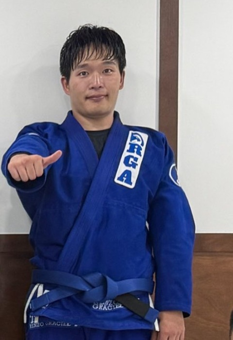

This is a write-up of a talk I gave at our internal TMI session. The topic, jiu-jitsu, has nothing to do with work — but the more I trained, the more it started to look like work.

I opened the talk with this sparring video: Mark Zuckerberg rolling with Lex Fridman.

<div style="position: relative; aspect-ratio: 16 / 9; margin: 1.5em 0;">
	<iframe src="https://www.youtube-nocookie.com/embed/1Wy-6z17up4" title="Mark Zuckerberg vs Lex Fridman in Jiu Jitsu" style="position: absolute; inset: 0; width: 100%; height: 100%; border: 0;" allow="accelerometer; autoplay; clipboard-write; encrypted-media; gyroscope; picture-in-picture" allowfullscreen loading="lazy"></iframe>
</div>

## Me and Jiu-Jitsu



Jiu-jitsu (BJJ) is a grappling martial art: you grab, take down, and pin your opponent, then make them **tap** with a joint lock or a choke. I started on January 1, 2025. One year and nine months later, I'm a blue belt — the second step on white → blue → purple → brown → black — and only now learning how to attack.

## What Does "Jiu-Jitsu" Mean?

- **柔** (gentle) + **術** (technique) = **柔術**, the gentle art. You don't meet force with force; you use your opponent's force.
- The Japanese pronunciation, "jūjutsu," was romanized in the West as **Jiu-Jitsu**, and Korean borrowed that English pronunciation as "주짓수."
- **BJJ** (Brazilian Jiu-Jitsu) is Japanese jūjutsu that traveled to Brazil and evolved around ground fighting. In Korea, "jiu-jitsu" usually means BJJ.

## Where It Came From

| Year | Event |
| --- | --- |
| 1914 | Mitsuyo Maeda, a student of judo founder Kanō Jigorō, arrives in Brazil and teaches Carlos Gracie |
| 1925 | Carlos opens the first Gracie academy in Rio de Janeiro |
| Later | Hélio Gracie, the small and frail youngest brother, refines the techniques to rely on leverage instead of strength |
| 1993 | Royce Gracie submits much bigger opponents to win UFC 1, and BJJ spreads worldwide |

In one line: **a technique for small people to beat big people.**

## Part 1. Why I Train

### Focus: Time Spent Fully in the Present

When a choke is closing in, nothing but the roll crosses your mind. Your attention goes 100% to your opponent's weight, grips, and breathing — **forced focus**. With no room for stray thoughts, your mind actually rests. It's close to moving meditation. After a four-minute roll, my brain feels rebooted.

### Problem Solving: Jiu-Jitsu Is a Real-Time State Machine

Positions are states.

- **Guard**: a neutral state where you can block and attack with your legs even from the bottom
- **Side control**: past the guard, pinning from the side. The worst place to be stuck
- **Mount**: sitting on top of your opponent, hunting for a submission
- **Back control**: owning their back — the most advantageous state

The game is moving into better states and blocking transitions into worse ones.

Take a chain of submissions from mount. Once you set a cross-collar choke (both hands in the collar), your opponent's reaction (the Event) decides your next move (the Transition).

- They can't defend → they tap
- They push with straight arms → **armbar**. The extended arm is the input to the next attack
- They turn away → **take the back, then choke**. The escape route leads somewhere worse
- Their elbow drops bent to the mat → **americana**. A bent arm is raw material for a shoulder lock

Blocking one door opens another. That's a chain, and designing it is the fun part. Written as code, it's just a switch statement.

```go
func MountAttack(opp Opponent) Result {
    grip := CrossCollarGrip()

    switch opp.React(grip) {
    case PushWithStraightArms:
        return Armbar(opp.Arm())
    case TurnAway:
        return TakeBack().Choke()
    case ElbowBentOnMat:
        return Americana(opp.Arm())
    default:
        return grip.Finish() // tap
    }
}
```

A good chain is a switch statement that handles every case. **Any unhandled case is your opponent's escape route.**

### Growth: Internalizing an Algorithm

Progress came in three stages.

1. **Survive** (early white belt): getting pinned makes it hard to even breathe. The goal is "tap a little less today." You start by learning how to breathe and how to escape.
2. **Defend** (late white belt): you get out from under and keep your guard. You start seeing your opponent's attacks telegraphed.
3. **Attack** (blue belt): you chain attacks together. You start designing the game.

What ran in between was a **learn → try → fail → debug** loop: take it in from class and videos, try it in sparring, get stuck and tapped, review why, fix it with drills. At first, I could watch a technique a hundred times on video and never once pull it off in a roll. Now, the moment someone extends an arm, I'm already moving to the armbar angle.

The tap is the most honest feedback there is. The more you fail, the faster the loop spins — and the faster it becomes part of you.

## Part 2. What's Good About It

### It Trains Body and Mind Together

- **Body**: full-body muscular endurance and core, flexibility, a sense of where your body is, and how to move against a resisting opponent
- **Mind**: setting your ego down by getting tapped every day, moving on judgment instead of emotion, and the persistence of "again next time"

If I got tapped a little less than yesterday, that's enough.

### A Feedback Loop That Runs in Four Minutes

At work, feedback goes planning → development → deploy → seeing the response, and takes days to weeks. On the mat, you get the result the moment you try. If it works, you get position; if not, you get tapped. Within one four-minute round, try → fail → adjust repeats nonstop. Repeating a short, honest loop with your body builds the habit of "try small, fail fast" at work too.

### Staying Calm Under Pressure, Then Reversing

Here's the escape sequence when you're stuck under side control with your opponent's full weight on your chest.

1. **Breathe**: no panic — get your breathing under control first
2. **Frame**: build braces with your arms to create space
3. **Hip escape**: shrimp out to create an angle
4. **Recover guard**: get your legs between you and your opponent
5. **Reverse**: sweep and come up on top

Patience is a technique too. Pushing with strength only burns energy. Stay calm, hold on, wait for the opening, and the game turns over.

### Slow Growth, Big Reward

There are no shortcuts. You can't buy a belt with money or talent, which is exactly why the achievement is real. A belt is a receipt for time spent on the mat. And growth compounds — one day, a technique that never worked suddenly does.

## Part 3. The Honest Downsides

### Injury: Speeding Causes Accidents

Like driving, if you go slow and don't obsess over winning, serious injuries are rare.

| Patterns that get you hurt | Patterns that keep you training |
| --- | --- |
| Holding out on pride (tapping late) | Tap early when it's lost, go again next round |
| Muscling through instead of using technique | Flow rolling, like practice |
| Hard sparring when you're exhausted | Adjusting intensity to how your body feels |

A study in the Orthopaedic Journal of Sports Medicine found 9.2 injuries per 1,000 competition exposures. That said, nagging injuries — fingers, ribs, a stiff neck — come standard. If you're too sensitive to every one, it's hard to last.

### Dropout: Most People Quit at White Belt

There are no official numbers, but ADCC champion Dean Lister estimates that 60 out of 100 people quit during white belt alone. Another estimate says half of new members quit within 90 days, and Rener Gracie says "90% quit before blue." The reasons roughly fall into three buckets.

- **Feeling like you're not improving**: at white belt you're pinned and tapped every day; at blue, growth turns into a long plateau
- **Losing curiosity**: when the novelty fades, so does the reason to keep going
- **Injury**: time off breaks your rhythm, and you never come back

## Part 4. Beyond Jiu-Jitsu

### Poke at New Hobbies, One at a Time

- **You have to explore to find the answer.** Jiu-jitsu started with "why not try it once." The right hobby isn't picked in your head — it shows up when you try it.
- **New input for your brain.** Unfamiliar movements, rules, and people wake up circuits you don't normally use.
- **More raw material for thinking.** Experience from a completely different field becomes metaphors and ideas for problems at work — like this post explaining jiu-jitsu as a switch statement.

James L. Adams's *Conceptual Blockbusting* argues that what blocks creativity isn't a lack of talent but conceptual walls in your head. The more experience you gather outside familiar frames, the lower those walls get.

### Stay out of the Comfort Zone

- **Comfort**: familiar and easy, but you learn nothing new
- **Learning**: a little scary and awkward. This is where growth happens
- **Panic**: go too far at once and you get hurt and quit — like speeding in jiu-jitsu

My first jiu-jitsu class looked like Panic, but once I actually went, it was Learning. Do the thing you're vaguely afraid of, a little at a time.

## What's Your "Jiu-Jitsu"?

For me, it just happened to be jiu-jitsu.

1. Pick one thing you've been vaguely afraid of — a sport, an instrument, writing, anything.
2. Try it once. Everyone feels awkward in their first class.
3. If it fits, keep going; if not, try the next one. That's how you find a hobby that means something.
